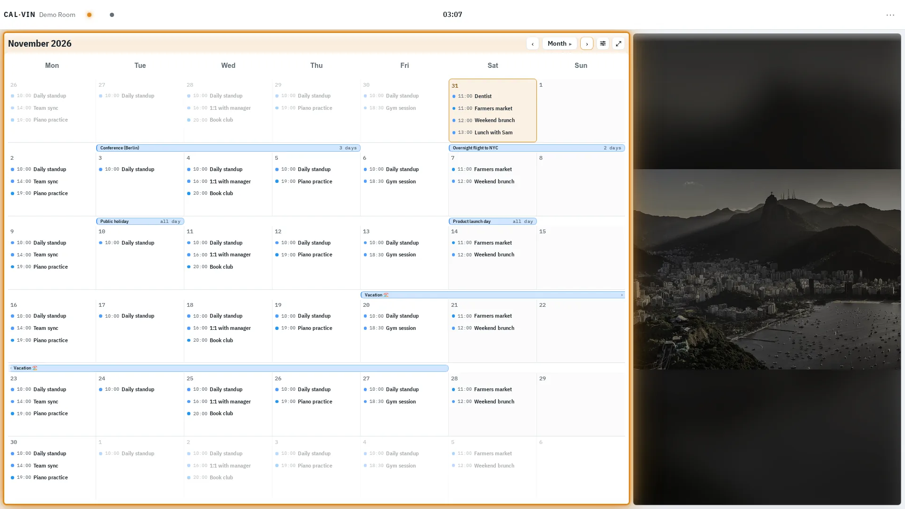
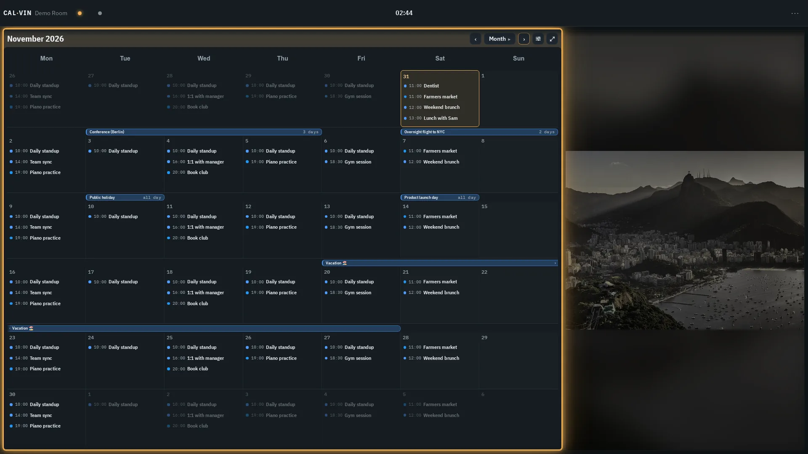
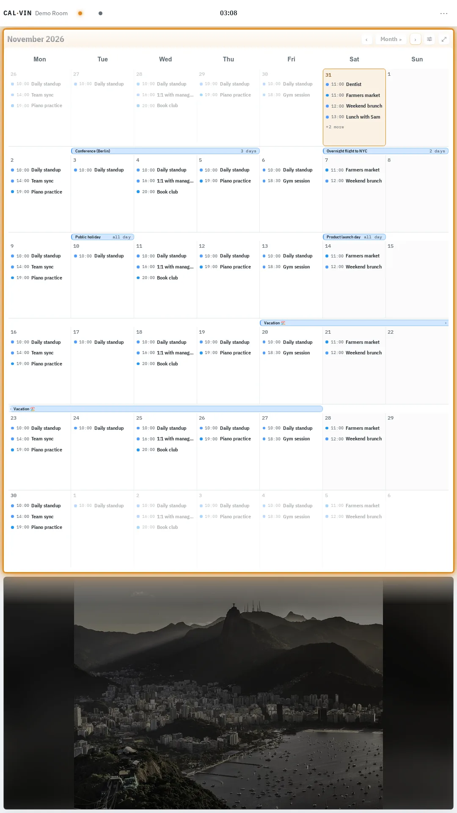
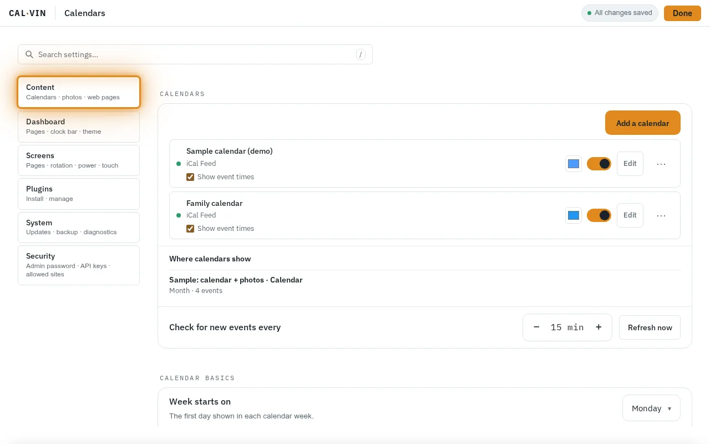
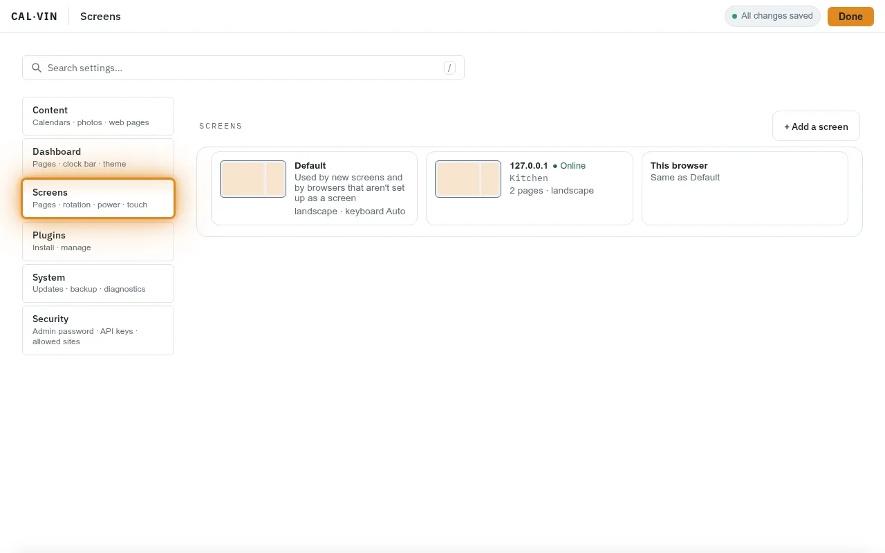
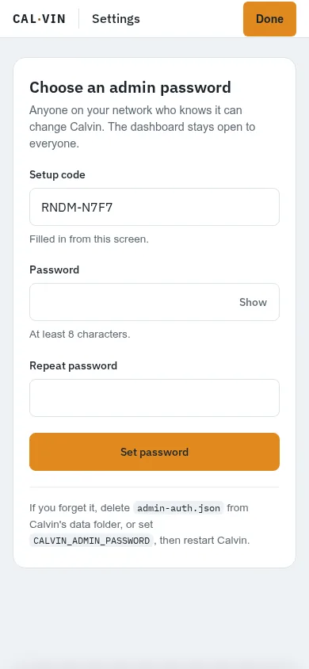
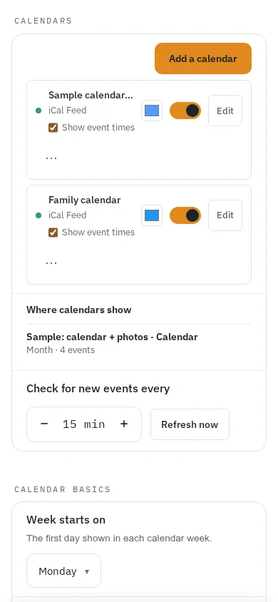

# Calvin — a self-hosted dashboard for your screens

**Calvin is a home or business LAN dashboard for a wall screen.** Put calendars,
photos and the web apps you check every day side by side, then drive that same
dashboard from a Raspberry Pi kiosk, a spare tablet, or any browser on the
network. One server holds the data; any number of screens show it. A plugin
system adds calendar providers, photo sources and web services without touching
the core.



## A quick look

**Light or dark, it is the same screen.** The shot above is light; the same
layout in dark keeps the calendar and photo readable at night.



**Portrait or landscape.** Turn the layout for a vertical screen, or stack the
calendar above the photo frame on a tall display.



**Settings from the couch.** Content and screens are managed from the same web
UI, on a laptop or a phone.

| Content                                                         | Screens                                                         |
| --------------------------------------------------------------- | --------------------------------------------------------------- |
|  |  |

**First run takes a minute.** A one-time setup code from the server log becomes
the admin password; after that you can add a calendar from your phone and see it
on the wall.

| Set up from a phone                                            | Content on a phone                                            |
| -------------------------------------------------------------- | ------------------------------------------------------------- |
|  |  |


_Screenshots and the recording were made with the sample data from
`make demo-seed`; see [frontend/scripts/capture-tour.mjs](frontend/scripts/capture-tour.mjs)
to regenerate them._

## Quick start

Calvin runs on a Raspberry Pi 3B+ or newer, or any always-on Linux host, with
Docker. The setup script installs the runtime and the kiosk browser for you.

**Stable release** — replace `vX.Y.Z` with the newest tag from
[Releases](https://github.com/osterbergsimon/calvin/releases):

```bash
curl -fsSL https://raw.githubusercontent.com/osterbergsimon/calvin/vX.Y.Z/scripts/setup.sh \
  | sudo GIT_BRANCH=vX.Y.Z bash
sudo reboot
```

The dashboard comes up at `http://<pi>:8000` after the reboot.

**Testers** can track `develop` (the `:develop` image is rebuilt on every push).
It is also the only installable ref until the first release is cut:

```bash
curl -fsSL https://raw.githubusercontent.com/osterbergsimon/calvin/develop/scripts/setup.sh | sudo bash
sudo reboot
```

The full walkthrough — first sign-in, finding the setup code, and what to do
next — is in [docs/setup/GETTING_STARTED.md](docs/setup/GETTING_STARTED.md).
Setup-script details are in
[docs/setup/SETUP_SCRIPTS.md](docs/setup/SETUP_SCRIPTS.md), and the three
deployment shapes are compared in
[docs/setup/DEPLOYMENT_TOPOLOGIES.md](docs/setup/DEPLOYMENT_TOPOLOGIES.md).

## ✨ Features

- **📅 Calendar Integration** — Google Calendar, ICS/CalDAV sources, and plugins
- **🖼️ Photo Slideshow** — Local folders, Immich, Unsplash, and more
- **🌐 Web Services** — Embed dashboards, maps, home-automation UIs
- **⌨️ Keyboard Navigation** — Compact 7-button keypads and full keyboards,
  handled in the browser (no kernel input devices needed)
- **🔌 Plugin System** — Calendar, image, service, and backend plugins
- **📱 Kiosk Mode** — One server, many displays; per-kiosk content and rotation
- **🐧 Cross-Platform** — Develop on Windows/Linux, deploy on Raspberry Pi

## 🚀 Prerequisites

Running Calvin (any topology below) needs:

- **Docker Engine + Compose v2** — on Raspberry Pi OS Bookworm/Trixie the setup
  script installs both; it is the only runtime dependency for the server.
- **Git** — to clone the repository.
- A **Raspberry Pi 3B+ or newer** (or any always-on Linux host) for deployment.

For **native development** (tests, linters, formatting) you also need:

- **Python 3.12+**
- **Node.js 20+**
- **uv** (installed by the dev setup scripts if missing)

## 🧭 Deployment shapes

The full comparison, including security caveats, is in
[docs/setup/DEPLOYMENT_TOPOLOGIES.md](docs/setup/DEPLOYMENT_TOPOLOGIES.md);
the guided tour is
[docs/setup/GETTING_STARTED.md](docs/setup/GETTING_STARTED.md).

### 1. All-in-one Pi (default)

One Pi runs the backend, the frontend, and the kiosk browser. Simplest option,
and the one to pick for a single display. Use the [quick start](#quick-start)
above; details are in [docs/setup/SETUP_LINUX.md](docs/setup/SETUP_LINUX.md).

### 2. Remote backend + kiosk Pi

A home server runs the backend (SQLite, photos, plugins); one or more Pis run
only Chromium pointed at the server URL. Use this to keep data off the SD card
or to drive several displays from one backend.

```bash
# Server: same Docker image as Mode A
docker compose -f docker/docker-compose.yml up -d

# Pi (kiosk only)
sudo bash scripts/setup-kiosk.sh --backend-url http://homeserver.local:8000
sudo reboot
```

Or install the kiosk straight from the running server:
`curl -fsSL http://homeserver.local:8000/api/kiosks/install.sh | sudo bash`.
See [KIOSK_INSTALL.md](docs/setup/KIOSK_INSTALL.md) and
[KIOSK_PROVISIONING.md](docs/setup/KIOSK_PROVISIONING.md).

### 3. Unraid / home-server Docker

Run the backend as a Docker container on Unraid (or any home server) and point
kiosk Pis at it. Follow the template and volume layout in
[docs/setup/UNRAID.md](docs/setup/UNRAID.md).

## 🛠️ Development

The dev workflow runs the whole stack in Docker: the backend with
`uvicorn --reload` and the frontend with Vite HMR, both bind-mounting your
checkout.

```bash
git clone https://github.com/osterbergsimon/calvin.git
cd calvin

make install   # one-time: creates docker/.env from docker/dev.env.example
make dev       # starts the dev stack and streams logs
```

- Frontend (HMR): <http://localhost:5173>
- Backend / API docs: <http://localhost:8000> · <http://localhost:8000/docs>

`make dev-down` stops the stack, `make doctor` checks Docker and ports, and
`make clean` removes the stack and its dev data. Windows uses the same targets
through `.\make.ps1`.

Each checkout gets its own compose project, so several worktrees can run at
once; give a second one different `CALVIN_PORT` / `CALVIN_FRONTEND_PORT`
values in its `docker/.env`. The dev data lives in `docker/.calvin-dev-data/`,
never in the host's `/var/lib/calvin`.

VS Code users can open the folder and run **Dev Containers: Reopen in
Container** to get the same stack with extensions pre-installed.

### Native toolchain (optional)

Tests, linting, formatting, and type checks run natively:

```bash
cd backend
uv sync --extra dev
uv run pytest

cd ../frontend
npm install
npm test          # vitest run (one shot)
npm run test:watch
```

`make test`, `make lint`, `make format`, and `make type-check` wrap these.
Linux contributors have the same targets; NixOS users can `nix-shell` for a
pinned toolchain.

**Keyboard support** is browser-side: `KeyboardHandler.vue` listens for DOM
`keydown` events; there is no backend hardware-keyboard (`evdev`) path, so no
kernel headers or `--extra linux` install are needed.

### README screenshots

`npm run capture:tour` in `frontend/` boots a throwaway Calvin on free ports
with `make demo-seed` data, drives it with Playwright, and writes the optimised
assets under `docs/images/tour/`. It runs with `CALVIN_HOST_CONTROL=0` and
intercepts every host-acting route.

## 📁 Project Structure

```
calvin/
├── backend/          # FastAPI backend
│   ├── app/
│   │   ├── api/      # API routes
│   │   ├── models/   # Data models
│   │   ├── plugins/  # Plugin system
│   │   ├── services/ # Business logic
│   │   └── utils/    # Utilities
│   └── tests/        # Test suite
├── frontend/         # Vue 3 frontend
│   └── src/
│       ├── components/  # Vue components
│       ├── stores/      # Pinia stores
│       └── services/    # API services
├── docker/           # Dockerfile + compose files (prod and dev)
├── deploy/           # systemd units, kiosk agent, production env example
├── scripts/          # Setup scripts and CI helpers
└── docs/             # Documentation
```

Runtime data (`CALVIN_DATA_DIR`: SQLite, images, plugins) lives outside the
checkout — `/var/lib/calvin` in production, `docker/.calvin-dev-data/` in dev.

## 🔌 Plugin System

Plugins are self-contained directories with a `plugin.json`, a `plugin.py`,
and optional pre-built frontend assets. They install live — no restart and no
host-side rebuild.

- [Plugin Development Guide](docs/plugins/PLUGIN_DEVELOPMENT_GUIDE.md)
- [Plugin Installation](docs/plugins/PLUGIN_INSTALLATION.md)
- [Plugin Package Format](docs/plugins/PLUGIN_PACKAGE_FORMAT.md)

The reference plugins live in
[osterbergsimon/calvin-plugins](https://github.com/osterbergsimon/calvin-plugins).

## 📚 Documentation

- **Online documentation**: <https://osterbergsimon.github.io/calvin/>
- **Releases**: <https://github.com/osterbergsimon/calvin/releases> · process in [docs/RELEASING.md](docs/RELEASING.md)
- **Getting started**: [docs/setup/GETTING_STARTED.md](docs/setup/GETTING_STARTED.md)
- **Deployment topologies**: [docs/setup/DEPLOYMENT_TOPOLOGIES.md](docs/setup/DEPLOYMENT_TOPOLOGIES.md)
- **Documentation index**: [docs/index.md](docs/index.md)
- **Locally**: `mkdocs serve` from the project root

## 🤝 Contributing

Calvin is an open project and contributions of every size are welcome.

- **[CONTRIBUTING.md](CONTRIBUTING.md)** — development setup, the branch model
  (branch from `develop`, pull requests into `develop`), conventional commit
  messages, and the quality gates (`make lint`, `make type-check`, `make test`)
- **[Code of Conduct](CODE_OF_CONDUCT.md)** — Contributor Covenant 2.1; this is
  how we expect people to treat each other here
- **[SECURITY.md](SECURITY.md)** — report a vulnerability privately through
  GitHub; please never open a public issue for a security problem
- **[Issue templates](.github/ISSUE_TEMPLATE/)** — bug reports ask for your
  deployment, Pi model, and logs; feature requests are welcome too
- **Plugin work** belongs in
  [osterbergsimon/calvin-plugins](https://github.com/osterbergsimon/calvin-plugins),
  not in this repository

## 📄 License

GPLv3 — see [LICENSE](LICENSE).
