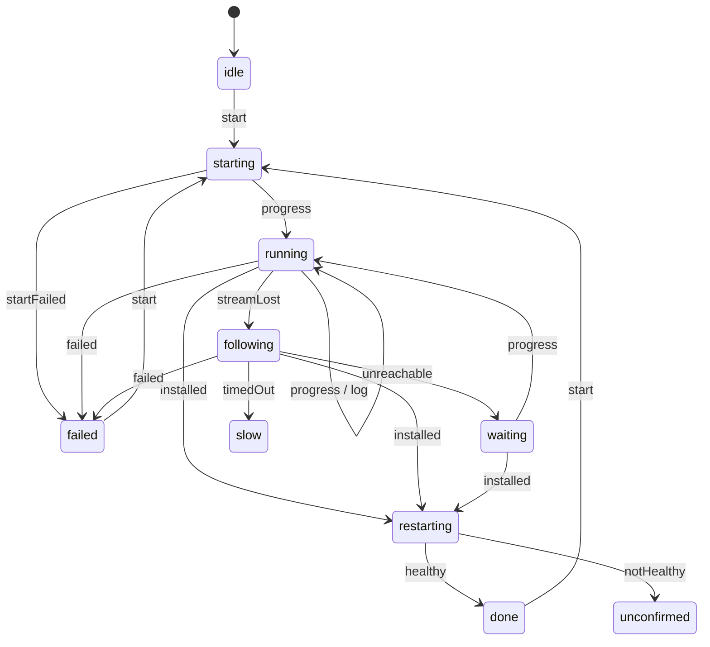

# Implicit state machines in Calvin

**Date:** 2026-11-14
**Scope:** `frontend/src`, `backend/app`, `scripts/update-calvin.sh`, `deploy/kiosk-agent`.

An implicit state machine is state spread over several flags, strings or files whose combinations mean something
nobody wrote down: which combinations can happen, which event moves it on, and what the person sees in each. The cost
shows up three ways: impossible combinations become reachable (UX), every reader has to rebuild the machine in their
head (DX), and an agent changing one handler cannot see the rest (AX).

The rule used below: make a machine explicit when it **crosses a boundary** (bash, Python, browser, kiosk), when it has
**a reachable bad state**, or when **two places spell the same state differently**. A flow inside one component that
already reads clearly stays as it is.

## Summary

| # | Machine | Where | Verdict |
|---|---|---|---|
| 1 | Calvin's own update | `update-calvin.sh` → `system.py` → `useSystem.js` → `UpdatesTab.vue` | **Made explicit** (this change) |
| 2 | Kiosk software update | `kiosk_registry.py` flag + status · `calvin_display_agent.py` · `ScreensSettings.vue` | **Follow-up: stuck state** |
| 3 | Display check run | `display_check.py` · `DisplayCheckDialog.vue` | Follow-up (medium) |
| 4 | Backup restore | `BackupSettings.vue` | Follow-up (small) |
| 5 | Photo frame mode | `usePhotoFrameMode.js` | Leave; note |
| 6 | On-screen keyboard | `useOnScreenKeyboard.js` | Leave |
| 7 | Plugin install | `usePlugins.js` | Leave |
| 8 | Admin password form | `AdminAccessSection.vue` | Leave |
| 9 | Settings save | `useConfigForm.js` | Leave |
| — | Already explicit | `stores/auth.js` (`status` union), `stores/connection.js` (derived `status`), `GuestShare.vue` (`state`), `ApiKeysSection.vue` (`copyState`), phone Settings (the URL is the state, `useSettingsPhoneNav.js`) | Good models to copy |

## 1. Calvin's own update — made explicit

**Before.** One update, four vocabularies and three ways to decide it was over:

- The script wrote `running | success | error` plus a phase (`starting`, `healthcheck`, `pulling_code`,
  `pulling_image`, `refreshing_host`, `restarting`, `rollback`, `complete`).
- The status endpoint turned `success` into `idle`; the stream turned `idle` into `complete`. A log-scraping fallback
  guessed status from phrases like "update complete!".
- The browser kept `updating`, `updateStatus`, `updateMessage` and `updateMessageClass` in step by hand, and chose
  progress words by searching log lines.
- `UpdatesTab.vue` had its own phase table that knew 2 of the script's 8 phases (`rollback` showed nothing).

**Bug.** The stream's `disconnected` was handled like `complete`. A dropped connection in the middle of an update
waited for Calvin's health check, which passes while the old Calvin still runs, and said **"Calvin is up to date."**
The polling path that could have checked the server (`pollUpdateStatus`) was never called by the app.

**Now.**

- `backend/app/services/update_lifecycle.py` owns the server vocabulary: script statuses, phases, API statuses, the
  stream's `complete`, and the mapping between them. `system.py` uses it; the API is unchanged.
- `frontend/src/utils/updateLifecycle.js` is the browser's machine: a pure `nextUpdate(state, event)` and an
  `updateView(state)` table of what each state says. Events that do not apply are ignored, so a late stream event
  cannot undo "up to date". `useSystem.js` sends events; `updating` and the message line are derived.
- A dropped stream moves to `following`: the browser asks `/update/status` until the server says done or failed, and
  shows "Calvin is restarting…" while it does not answer.
- Every script phase has plain words, including the rollback.
- Tests on both sides read `scripts/update-calvin.sh`: a new phase or status there fails CI until it has a meaning in
  Python and words in the browser.

## 2. Kiosk software update — stuck state (follow-up)

**State:** a host-internal flag `_agentUpdateRequested` stored in the screen's override layer; a status column
(`updating` set by the server, then whatever the agent reports: `ok | running | success | error…`); a message; the
agent's own `agent-update-state.json` with a `phase` (`python-too-old`, rollback, …) that never reaches the server.

**Bug.** The flag clears only when the agent reports the target version. When an update fails, the agent never
retries that version (`last_failed_version`), so the flag stays set for good. `ScreensSettings.vue` checks the flag
first, so the screen shows **"Updating to x.y…"** indefinitely and never reaches its own "last update failed, kept
this version" line. Separately, "blocked by an old OS" is detected by the message containing "python", although the
agent knows the phase.

**Proposal.** The agent reports the version that failed and the phase (two optional fields, older agents keep
working). The server clears the flag when the failed version is the requested one and stores the phase. The browser
derives one state per screen (`current | behind | updating | failed | blocked`) in `utils/kioskSoftware.js` from those
fields instead of from message text. Needs an agent bundle release, so it is its own change.

## 3. Display check run (follow-up, medium)

**State:** server run `status` (`requested | running | done | error | timeout`, `timeout` derived on read) and `step`;
dialog `step` number, `view`, and nine booleans. It already has a server-side vocabulary; the dialog's half is the
implicit part. Worth a reducer like the update's when the dialog is next changed, not before.

## 4. Backup restore (follow-up, small)

**State:** `file`, `plan`, `previewing`, `restoring`, `result`, `restoreError`. Combinations such as previewing while
restoring are prevented only by disabled buttons. One `stage` (`pick | previewing | review | restoring | done |
failed`) would make the wizard's steps and its error placement read straight from the template.

## 5. Photo frame mode (leave, note)

`isPhotoFrameActive`, an inactivity timer, `savedSideViewMode`, a throttle and `isResettingTimer`. It is one component's
idle timer and reads clearly; the recent idle-start fix (calvin-agnx) was in when the timer starts, not in the shape.
Revisit only if a third trigger (beyond touch and keys) is added.

## 6–9. Leave as they are

- **On-screen keyboard:** `visible`, `target`, `focusedTarget`, `dismissedTarget`, shift, caps, picker. These are
  independent facts (which field, which modifiers), not one state; a single enum would hide that.
- **Plugin install:** `installingPlugin`, `enumeratingPlugins`, `pluginInstallError`, `pluginInstallSuccess`,
  `pluginBranchSwitched`. Each attempt clears both messages when it starts, and one install runs at a time; a machine
  would not add much.
- **Admin password form:** form-local and short-lived.
- **Settings save:** `saveStatus` is already derived from `error`, `saveSuccess` and `lastSavedKeys`.

## Patterns to reuse

- **Derive, don't sync.** `connection.js` computes `status` from its inputs; the update's `updating` and message are
  now computed from one state. Fewer writers, no drift.
- **The server's words once.** A status that crosses a boundary gets one module on each side and a test that reads the
  producer (here the update script).
- **Ignore what does not apply.** A transition function that returns the same state for an out-of-place event makes
  late and duplicate events harmless.
